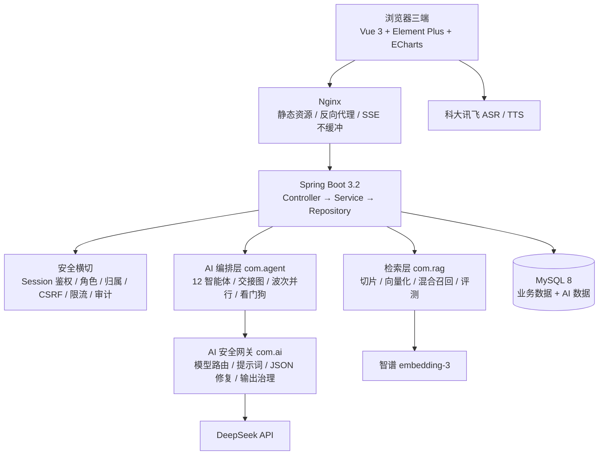

# 智枢学堂 · ZhiYan Academy

> 基于多模态大模型的个性化资源生成与多智能体学习平台
>
> 2026 年第九届「传智杯」全国大学生数智创新与 AI 应用大赛 · **AI WEB 网页开发挑战赛（团队赛）**
>
> 参赛组别：**B 组**　|　学校：**重庆城市科技学院**　|　团队：**祝司晨、付杰、朱建宇**
>
> 指导教师：**钟荗胜、李路加**

智枢学堂面向高等院校的日常教学环节，以「大模型驱动的多智能体协作」为内核，把学情诊断、个性化资源生成、练习与评测、学习画像串成一条可运行的教学闭环。平台设置**教务管理员、教师、学生**三个角色端，覆盖课程、作业、考试、考勤、互评、查重、学情分析、AI 辅导等 22+ 功能模块。

- 在线演示：<http://47.115.231.84/login>
- 代码仓库：<https://github.com/Auroranchen/ZhiYan-Academy>
- 技术文档：随赛事提交包提供（`03_技术文档/智枢学堂技术文档_25页.pdf`），仓库内不重复存放
- 演示视频：随赛事提交包提供（`02_演示视频/智枢学堂作品演示视频.mp4`）

---

## 一、项目简介

一门专业基础课往往面向数百名学生，教师与学生之间是「一对多」的广播关系：教师即使了解每个学生的薄弱点，也缺少为不同学生分别准备材料、分别出题、分别辅导的时间。智枢学堂把「一对一辅导才有的针对性」拆解为一组可自动化执行的动作：

1. **诊断**：从作业、考试、错题本中定位具体到知识点的薄弱项；
2. **规划**：按薄弱点生成分阶段学习路径与验收标准；
3. **生成**：12 个教学智能体协作产出讲义、思维导图、分层练习、拓展阅读、代码实操案例、讲解动画；
4. **练习与评测**：确定性判分、错题归集、掌握度前后测；
5. **评估与调整**：6 维学习画像随学情更新，驱动下一轮资源推送。

平台不替代教师，而是把教师从「重复生产内容」中解放出来，让教师把时间花在教学设计、个别辅导与教学决策上。所有 AI 生成内容在界面中标注「AI 生成内容，仅供参考」。

## 二、核心能力

| 能力 | 说明 |
|---|---|
| 学习多智能体工作台 | 12 个智能体交接驱动编排，一次触发产出 7 类资源与质量复审；SSE 实时展示每一步状态、耗时与并行路数 |
| 对话式学习画像 | 学生与 AI 助手自然对话，自动维护知识基础、认知风格、易错点偏好、学习目标、学习节奏、兴趣方向 6 个维度，雷达图呈现 |
| AI 讲解动画微课 | 生成 6–8 个分镜脚本，前端 SVG/CSS 动效 + 讯飞 TTS 旁白 + 实时字幕，零录制产出「会讲课」的微课 |
| AI 思维导图 | 结构化知识树 + 节点 AI 释义，支持导出图片 |
| AI 学情周报 / 班级报告 | 基于作业、考试、错题、积分数据生成图文报告，支持 PDF 导出 |
| AI 辅助批改 / 查重 | 客观题确定性判分、主观题 AI 辅助批改、代码高亮、原创性检测、作业互评 |
| AI 智能练习 / 错题本 | 错题变式训练、答对归档、薄弱点回流资源推荐 |
| 防幻觉与内容安全 | 统一 AI 安全网关：输入消洗、Ground Truth 约束、输出过滤、调用审计、AI 内容标识 |
| 三端完整业务 | 教务管理员端、教师端、学生端；课程、班级、作业、考试、考勤、通知、消息、统计、审计 |

## 三、技术架构



**前端**：Vue 3.3 + Vue Router 4 + Vuex 4 + Element Plus + ECharts + Axios + DOMPurify + Iconify；Vue CLI 5 / webpack 构建；Vitest 单元测试；统一设计令牌（颜色/间距/字号）支持明暗主题与响应式布局。

**后端**：JDK 17 + Spring Boot 3.2 + Spring Security 6 + MyBatis + Flyway + MySQL 8；`com.agent`（多智能体编排）、`com.rag`（检索）、`com.ai`（模型路由/提示词/安全网关）三层独立；统一 `Result` 响应与全局异常处理。

**AI 服务**：DeepSeek（对话与内容生成；流水线场景可切 `deepseek-flash`）、智谱 embedding-3（文本向量）、科大讯飞（语音听写/合成）。所有调用经统一 AI 安全网关，业务层不绑定具体模型供应商。

## 四、目录结构

```text
zhiyan-academy/
├── server/                     # Spring Boot 后端
│   ├── src/main/java/com/
│   │   ├── agent/              # 12 智能体词表、交接图/波次规划
│   │   ├── ai/                 # 模型路由、提示词、JSON 修复
│   │   ├── rag/                # 切片、向量化、混合召回
│   │   ├── controller/         # 41 个 REST Controller
│   │   ├── service/            # 业务与 AI 编排
│   │   ├── repository/         # AI 数据仓储
│   │   ├── mapper/ model/ dto/ # MyBatis 与模型
│   │   └── config/             # 安全、拦截器、线程池、WebSocket
│   ├── src/main/resources/
│   │   ├── db/migration/       # Flyway SQL 迁移
│   │   ├── mybatis/mappers/    # Mapper XML
│   │   └── application.yml     # 主配置（密钥走环境变量/本地文件）
│   ├── config/application-secrets.example.yml
│   ├── docs/                   # 设计文档（多智能体并行等）
│   ├── eval/ eval-results/     # RAG 评测语料与报告
│   └── zhzyai.sql              # 完整建库/演示数据脚本
├── web/                        # Vue 3 前端
│   ├── src/views/              # 74 个页面（admin/teacher/student）
│   ├── src/components/         # 工作台、AI 助手、代码面板等
│   ├── src/api/ utils/ store/  # 接口、SSE、状态
│   ├── src/assets/styles/      # 设计令牌与全局样式
│   ├── dist/                   # 已构建产物（可直接由 Nginx 托管）
│   └── nginx-zya.conf          # 生产 Nginx 参考配置
├── README.md
├── NOTICE.md
└── .gitignore
```

## 五、快速开始

### 1. 环境要求

| 依赖 | 版本 |
|---|---|
| JDK | 17+ |
| Maven | 3.9+ |
| MySQL | 8.0+ |
| Node.js | 20 LTS（18+ 可用） |
| npm | 9+ |

### 2. 初始化数据库

```sql
CREATE DATABASE IF NOT EXISTS zhzyai DEFAULT CHARACTER SET utf8mb4 COLLATE utf8mb4_unicode_ci;
```

```bash
mysql -u root -p zhzyai < server/zhzyai.sql
```

> 脚本包含完整表结构与演示数据；也可以让 Flyway 在空库上执行基线迁移，但首次演示建议直接导入 `zhzyai.sql`。

### 3. 配置密钥

```bash
cd server
cp config/application-secrets.example.yml config/application-secrets.yml
```

编辑 `config/application-secrets.yml`，至少填写：

- `DB_PASSWORD`：本机 MySQL 密码；
- `ai.zhipu.api-key`：DeepSeek API Key（也可用环境变量 `AI_API_KEY`）；
- 如需语音：`ai.xfyun.*` / `ai.xfyun-tts.*`；
- 如需真实语义检索：`app.rag.embedding.provider: zhipu` 并填写 `app.rag.embedding.api-key`。

也可以完全使用环境变量（推荐）：

```bash
DB_PASSWORD=your-db-password
AI_API_KEY=your-deepseek-key
ZHIPU_API_KEY=your-embedding-key
XFYUN_APP_ID=... XFYUN_API_KEY=... XFYUN_API_SECRET=...
XFYUN_TTS_APP_ID=... XFYUN_TTS_API_KEY=... XFYUN_TTS_API_SECRET=...
```

> `config/application-secrets.yml` 已被 `.gitignore` 忽略；不要提交真实密钥。

### 4. 启动后端

```bash
cd server
mvn spring-boot:run
```

默认 `dev` profile，端口 **8083**，上下文路径 **`/ZhiYanAcademy`**。健康检查：`http://localhost:8083/ZhiYanAcademy/actuator/health`（非本地访问需 `X-Actuator-Token`）。

### 5. 启动前端

```bash
cd web
npm install
npm run serve
```

开发地址 **http://127.0.0.1:8084**，已配置 `/ZhiYanAcademy` 代理到 `http://localhost:8083`、`/api-iconify` 代理到 Iconify。

### 6. 演示账号

| 角色 | 账号 | 密码 |
|---|---|---|
| 学生 | `2023001001` | `123456` |
| 教师 | `T2020001` | `123456` |
| 管理员 | `admin` | `123456` |

> 以上仅为赛事演示账号；评审结束后请修改密码或关闭演示环境。

## 六、环境变量

| 变量 | 说明 | 默认 |
|---|---|---|
| `SPRING_PROFILES_ACTIVE` | 运行环境 | `dev` |
| `DB_HOST` / `DB_PORT` / `DB_NAME` | 生产数据库 | `localhost` / `3306` / `ZYA` |
| `DB_USERNAME` / `DB_PASSWORD` | 数据库账号/密码 | `root`（dev）/ 空 |
| `AI_API_URL` | OpenAI 兼容对话接口 | `https://api.deepseek.com/chat/completions` |
| `AI_API_KEY` | 对话模型 Key | 空 |
| `AI_MODEL` | 默认对话模型 | `deepseek-chat` |
| `AI_PIPELINE_MODEL` | 流水线场景模型 | `deepseek-flash` |
| `ZHIPU_API_KEY` | 智谱 embedding Key | 空 |
| `RAG_EMBED_PROVIDER` | `local` / `zhipu` | `local` |
| `XFYUN_*` / `XFYUN_TTS_*` | 讯飞语音听写/合成 | 空 |
| `MAIL_USERNAME` / `MAIL_PASSWORD` | 邮件通知（可选） | 空 |
| `WECHAT_MINI_APP_ID` / `WECHAT_MINI_APP_SECRET` | 微信小程序（可选） | 空 |
| `ACTUATOR_TOKEN` | Actuator 访问令牌 | 空 |
| `WEB_ALLOWED_ORIGINS` | CORS 白名单 | `http://localhost:8080,http://127.0.0.1:8080` |

完整配置见 `server/src/main/resources/application.yml`；密钥模板见 `server/config/application-secrets.example.yml`。

## 七、测试与评测

```bash
# 后端：单元 + 集成测试（集成测试需要 Docker/Testcontainers，无 Docker 时自动跳过）
cd server
mvn verify

# 前端：lint + 设计令牌校验 + Vitest + 构建
cd web
npm run verify
```

当前测试资产：

- 后端 54 个测试类、306 个 `@Test`（surefire 实测 307 项，7 项 Docker 集成测试在无容器环境跳过），0 失败；
- 前端 32 个测试文件、约 380 项 Vitest 用例；
- JaCoCo 指令覆盖 17.7%、分支 12.4%（如实披露，控制层/映射层覆盖偏低）；
- RAG 评测：13 道金标准（9 可答 + 4 负样本）、43 份语料、179 个切片、12 组消融变体；基线混合召回命中率 88.9%；
- 越狱评测：12 条诱导话术，复用生产环境同一检测器；
- 流水线实测：无返工约 51.6s，有返工约 61.9s（有返工路径尚未达到 1 分钟目标，已列入后续优化）。

评测报告见 `server/eval-results/report.md`，复跑入口见 `server/src/test/java/com/eval/`。

## 八、部署

### 方式一：Nginx + 前端 dist + 后端 jar（推荐）

```bash
cd server
mvn -DskipTests package
java -jar target/ZhiYanAcademy-server-3.2.0.jar --spring.profiles.active=prod
```

```bash
cd web
npm run build
# 将 dist/ 上传到 Nginx 站点根目录
```

Nginx 参考 `web/nginx-zya.conf`，关键点：

- `location /` 回退 `index.html`（Vue history 路由）；
- `/ZhiYanAcademy/` 反向代理到后端；
- SSE 接口 `/agent/pipeline/stream` 需要 `proxy_buffering off`、`proxy_read_timeout 600s`；
- WebSocket（签到/通知）需要 `Upgrade` 头；
- 生产环境启用 HTTPS，并把会话 Cookie 的 `secure` 设为 `true`。

### 方式二：本地演示

按「五、快速开始」启动前后端即可；前端 `dist/` 也已随仓库提供，可直接由任意静态服务器托管。

## 九、AI 技术说明（简版）

- **多智能体编排**：12 个智能体分为「结构性前置（诊断/协调）→ 可重排内容段（规划/资源/思维导图/出题/阅读/代码实操/讲解动画）→ 结构性后置（评审/复审/编排）」。协调智能体声明的交接关系被服务端真实消费：拓扑排序决定执行顺序，按波次并行，上游产物摘要注入下游提示词，被压平的交接如实标记 `injected:false`。
- **RAG 混合召回**：`score = 0.55×语义相似度 + 0.30×内容词元覆盖率 + 0.10×标题命中率 + 0.05×精确短语命中`；经噪声阈值、单资料片段上限、Top-K 三步筛选；评测与生产共用同一份切片/打分实现。
- **模型路由**：按场景前缀选择模型（如 `agent.*` → 高吞吐模型），未命中回落默认模型；模型选择是配置而非硬编码。
- **安全与可信**：输入消洗、系统提示防幻觉约束、输出敏感过滤、JSON 本地修复、调用审计；作业辅导采用「强约束提示词 + 输出侧答案特征检测」双防线，受限状态由服务端提交记录判定（fail-closed）。
- **多模态产出**：文本（讲义/练习/报告）、图像（思维导图/雷达图/图表/PPT 页面）、语音（TTS 旁白/ASR 输入）、动画（分镜脚本 + 前端动效 + 配音）、文档（PPT/Word/PDF）。项目不依赖图像/视频生成模型，讲解动画是「脚本 + 前端动效 + TTS」的轻量多模态方案。

## 十、团队与分工

| 成员 | 学校 | 组别 | 分工 |
|---|---|---|---|
| 祝司晨 | 重庆城市科技学院 | B 组 | 三人平均分工，共同参与需求分析、架构设计、前后端开发、AI 能力集成、测试与文档 |
| 付杰 | 重庆城市科技学院 | B 组 | 同上 |
| 朱建宇 | 重庆城市科技学院 | B 组 | 同上 |

指导教师：钟荗胜、李路加。

> 团队三人对提交代码均有理解，可解释核心模块的设计与实现；具体答辩分工可在决赛前按实际补充。

## 十一、原创声明与第三方许可

- 本项目为团队原创参赛作品，未直接使用开源项目包装参赛；项目由早期课程作业管理原型逐步重构为 AI 原生教学平台。
- 使用到的开源组件及其许可证见 `NOTICE.md`；外部 AI/语音服务按各厂商条款使用。
- 开发过程中如使用 AI 编程辅助工具，仅用于草稿与文字润色，核心逻辑由团队设计、调试、验收；团队可解释全部提交代码。
- 仓库不包含任何真实密钥；`.gitignore` 已排除 `config/application-secrets.yml`。

## 十二、常见问题

**Q：启动后接口 401/403？**  
A：先登录；检查 `WEB_ALLOWED_ORIGINS`、会话 Cookie、CSRF Token；Nginx 反代时确认 `X-Forwarded-For` 与 `X-Forwarded-Proto`。

**Q：SSE 流水线中途断开？**  
A：确认 Nginx `proxy_buffering off`、`proxy_read_timeout 600s`；后端 SSE 超时 15 分钟，看门狗 10 分钟无推进会自动终止。

**Q：没有 AI Key 能跑吗？**  
A：可以启动和浏览业务功能；AI 生成类接口需要配置 `AI_API_KEY`。RAG 向量化默认 `local` 哈希向量器，无 Key 也能运行，但语义能力较弱。

**Q：数据库导入报错？**  
A：确认 MySQL 8、`utf8mb4`、数据库名 `zhzyai`；先建库再导入 `zhzyai.sql`。生产环境可用 Flyway 迁移，但首次演示建议直接导入完整脚本。

**Q：为什么仓库没有 node_modules / target？**  
A：依赖与构建产物不入库；按「五、快速开始」执行 `npm install` / `mvn package` 即可。

---

**智枢学堂 · 让每位学生，都拥有一支专属的 AI 教学团队。**
